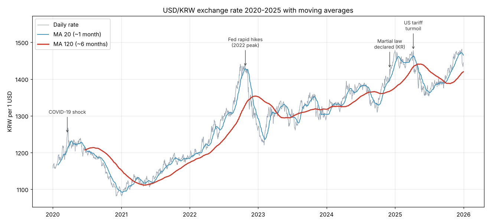
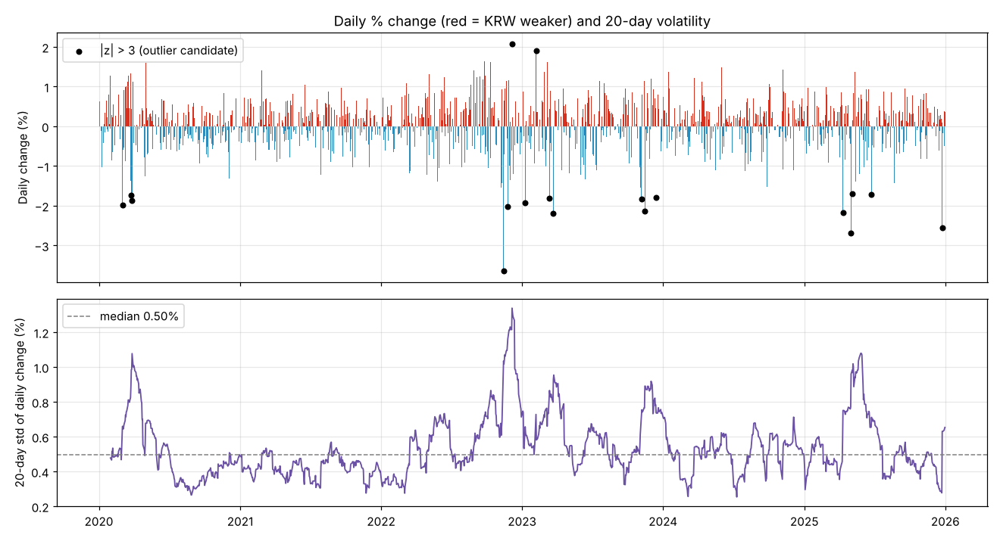
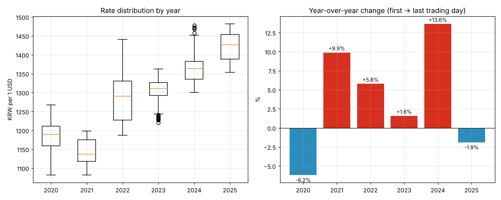
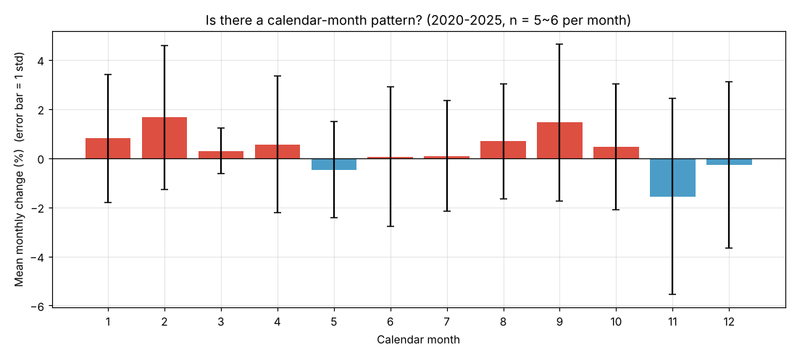
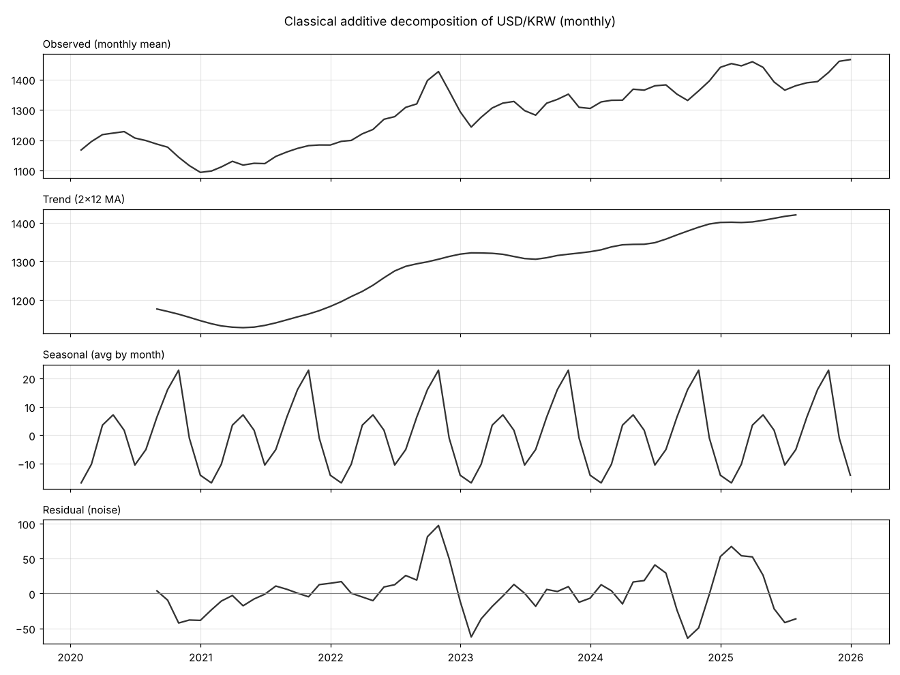
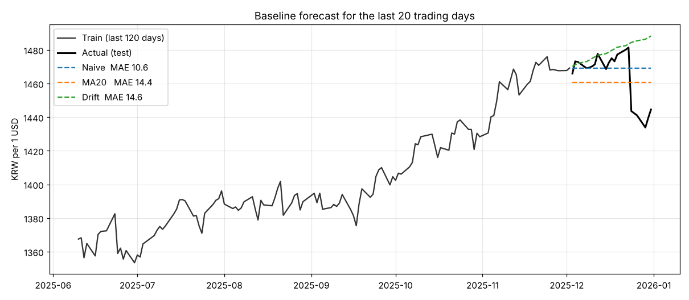

# 원/달러 환율 2020~2025 트렌드 분석 리포트

> 데이터: FRED `DEXKOUS` (원/달러 현물 환율, 일별) · 분석 기간 2020-01-02 ~ 2025-12-31 · 분석 코드 [`analysis.py`](analysis.py)
> 이 리포트의 모든 수치는 `python analysis.py` 실행 시 터미널에 출력되는 값과 `outputs/*.csv`에서 확인할 수 있습니다.

---

## 1. 분석 주제 및 선정 이유

- **주제:** 2020~2025년 원/달러 환율(1달러 = 몇 원)의 장기 추세, 변동성, 계절성 분석
- **선정 이유**
  - 해외 고객 대상 이커머스·해외 물류를 함께 하고 있어, 환율은 매출(원화 환산액)과 매입·배송비에 직접 영향을 주는 숫자다.
  - 2020~2025년은 코로나19, 미국의 급격한 금리 인상(2022), 국내 정치 이슈(2024-12), 미국 관세 정책(2025) 등 굵직한 외부 사건이 많았던 시기라 "숫자가 언제, 얼마나 크게 움직였는지"를 데이터로 확인해 보고 싶었다.
  - 감(感)으로 "요즘 환율 높다"가 아니라 **"얼마나, 언제부터, 얼마나 자주 흔들렸는지"** 를 수치로 말할 수 있게 되는 것이 목표.

## 2. 분석 질문

| # | 질문 | 유형 |
|---|------|------|
| Q1 | 2020~2025년 전체적으로 환율은 상승(원화 약세) 추세였는가? 추세가 바뀐 시점은 언제인가? | 그래프로 확인 |
| Q2 | 환율이 크게 흔들린(변동성이 높았던) 구간은 언제이고, 어떤 외부 이벤트와 겹치는가? | 그래프 + 추가 해석 |
| Q3 | 환율이 오를 때와 내릴 때 움직이는 방식이 다른가? (급등 vs 급락) | 그래프 + 추가 해석 |
| Q4 | 특정 달(월)에 환율이 오르거나 내리는 계절성이 있는가? | 그래프 + 통계로 검증 |

## 3. 데이터 설명

| 항목 | 내용 |
|------|------|
| 출처 | FRED (Federal Reserve Bank of St. Louis), 원 자료: Board of Governors of the Federal Reserve System, H.10 Foreign Exchange Rates |
| 시리즈 | `DEXKOUS` — South Korean Won to U.S. Dollar Spot Exchange Rate (단위: 원/달러) |
| 링크 | https://fred.stlouisfed.org/series/DEXKOUS |
| 기간 | 2020-01-02 ~ 2025-12-31 (일별, 평일) |
| 원본 행 수 | 1,565행 (평일 기준) |
| 컬럼 | `observation_date`(날짜), `DEXKOUS`(환율, 숫자) |
| 결측치 | 66건(4.2%) → 제거 후 **1,499개 데이터 포인트** (요구사항 100개 이상 충족) |
| 수집 방법 | FRED CSV 다운로드 URL: `https://fred.stlouisfed.org/graph/fredgraph.csv?id=DEXKOUS&cosd=2020-01-01&coed=2025-12-31` (자세한 내용: [`data/README.md`](data/README.md)) |

### 3-1. 결측치 처리

- **관찰:** 결측 66건은 모두 평일이며 요일 분포가 월요일 39건, 목요일 11건, 금요일 9건 등이다. 날짜를 보면 1월 셋째 월요일(마틴 루터 킹 데이), 7월 4일, 11월 넷째 목요일(추수감사절) 등 **미국 연방 공휴일**과 일치한다. (전체 목록: `outputs/missing_dates.csv`)
- **원인:** 이 환율은 뉴욕 연준이 미국 영업일에만 고시하는 값이라, 미국 공휴일에는 값이 없다.
- **처리 기준:** 그날은 "값이 누락된 것"이 아니라 "고시 자체가 없던 날"이므로 **보간하지 않고 제거(dropna)** 했다. 앞 값으로 채우면(ffill) 변화율 0%인 가짜 날이 생겨 변동성이 실제보다 낮게 계산되기 때문이다.

### 3-2. 이상치 처리

- **기준:** 일간 변화율의 z-score 절댓값이 3을 넘는 날(평균에서 표준편차 3배 이상 벗어난 날)을 이상치 후보로 표시 → **18건** (`outputs/outliers.csv`)
- **확인:** 가격 수준은 1,081.62 ~ 1,481.45원 범위로 0·음수·자릿수 오류 같은 입력 오류는 없었다. 18건은 모두 앞뒤 날짜와 자연스럽게 이어지는 값(하루짜리 튀는 오타 형태가 아님)이고, 대부분 2020-03(코로나), 2022-11(미국 물가 발표), 2025-04~05(관세 이슈) 등 변동성이 높았던 구간에 몰려 있어 실제 시장 급변으로 판단했다.
- **처리:** **삭제하지 않고 그래프에 표시만** 했다. 급변 자체가 이 분석의 관심 대상(Q2, Q3)이라 지우면 핵심 정보가 사라지기 때문이다.

## 4. 적용한 시계열 분석 기법

| 기법 | 적용 방법 | 왜 썼는가 |
|------|-----------|-----------|
| **이동평균** | 20일(≈1개월), 60일, 120일(≈6개월) 단순 이동평균 | 매일의 잡음을 걸러 "큰 방향(추세)"을 보기 위해 |
| **변화율** | 전 거래일 대비 일간 변화율(%) | 환율 수준(1,100원 vs 1,400원)이 달라도 움직임 크기를 같은 기준으로 비교하기 위해 |
| **변동성(이동 표준편차)** | 일간 변화율의 20거래일 이동 표준편차 | "얼마나 흔들렸는가"를 숫자 하나로 나타내 구간끼리 비교하기 위해 |
| **구간별 통계** | 연도별 시작/끝/평균/최소/최대/변화율 | 해마다 성격이 달랐는지 비교하기 위해 |
| **월별 집계** | 월말 환율 기준 월간 변화율 → 달력 월(1~12월)별 평균 | 계절성(Q4) 확인용 |
| (보너스) **시계열 분해** | 월평균 → 2×12 이동평균(추세) / 월별 평균 편차(계절성) / 나머지(노이즈) | 추세·계절성·노이즈가 각각 얼마나 큰지 분리해서 보기 위해 |
| (보너스) **베이스라인 예측** | 마지막 20거래일을 숨기고 단순 모델 3개로 예측 | "아주 단순한 방법이 얼마나 맞는가"를 기준선으로 확인 |

**집계 단위 선택 근거:** 추세·변동성은 사건의 날짜를 정확히 짚기 위해 **일 단위**, 계절성은 일별 잡음이 너무 커서 **월 단위**로 집계했다.

## 5. 분석 결과 및 시각화

### 그림 1. 환율 추이와 이동평균 (Q1)

- 전체 기간: **1,157.95원 → 1,444.55원 (+24.8%)**
- 최저 **1,081.62원(2021-01-04)** → 최고 **1,481.45원(2025-12-23)**, 저점 대비 약 +37%
- 120일 이동평균(빨간 선)은 2021년 초 바닥을 찍은 뒤 대체로 우상향. 환율이 120일선 **위에 있던 날이 63.8%**.
- 세로축은 0이 아니라 데이터 범위(약 1,050~1,570원)에 맞췄다. 0부터 그리면 변화가 평평하게 보이기 때문이다.

### 그림 2. 일간 변화율과 20일 변동성 (Q2, Q3)

- 20일 변동성 중앙값은 **0.50%**. 이 값의 2배 이상으로 튄 구간은 **2022-12(최대 1.34%)**, **2022-11(1.22%)**, **2025-05(1.08%)**, **2020-03(1.08%)**.
- 검은 점(|z|>3) 18개 중 **16개가 아래쪽(원화 강세 방향)** 이다.

### 그림 3. 연도별 분포와 연간 변화율 (Q1)

| 연도 | 시작 | 끝 | 평균 | 최소 | 최대 | 연간 변화 | 일간 변동성(표준편차) |
|------|------|-----|------|------|------|-----------|------|
| 2020 | 1,157.95 | 1,086.11 | 1,180.56 | 1,081.85 | 1,267.25 | **-6.2%** | 0.53% |
| 2021 | 1,081.62 | 1,188.59 | 1,144.89 | 1,081.62 | 1,198.72 | +9.9% | 0.42% |
| 2022 | 1,191.39 | 1,260.18 | 1,291.78 | 1,186.96 | 1,440.50 | +5.8% | **0.66%** |
| 2023 | 1,271.10 | 1,290.97 | 1,306.76 | 1,220.34 | 1,362.94 | +1.6% | 0.63% |
| 2024 | 1,300.52 | 1,477.86 | 1,363.44 | 1,300.52 | 1,477.86 | **+13.6%** | 0.50% |
| 2025 | 1,472.52 | 1,444.55 | 1,421.40 | 1,353.50 | 1,481.45 | -1.9% | 0.59% |

- 연평균 환율은 2021년(1,144.89원)을 빼면 **매년 올라갔다** (1,180 → 1,145 → 1,292 → 1,307 → 1,363 → 1,421).
- 2022년은 연간 변화율은 +5.8%로 크지 않지만 **최소~최대 폭이 253.5원**으로 6년 중 가장 컸다 → "끝값만 보면 놓치는 해".

### 그림 4. 달력 월별 평균 변화율 (Q4)

- 평균만 보면 2월(+1.66%), 9월(+1.46%)이 오르고 11월(-1.56%)이 내린 것처럼 보인다.
- 하지만 **오차 막대(표준편차 0.9~4.0%)가 평균보다 훨씬 크고**, 달마다 표본이 5~6개(=6년)뿐이다.

### 그림 5. (보너스 A) 시계열 분해 — 추세 / 계절성 / 노이즈

- **추세:** 1,128원 → 1,421원 (폭 약 292원)
- **계절성:** 월별 계절 지수 범위 -16.8원(1월) ~ +22.9원(10월), 진폭 약 40원
- **노이즈(잔차):** 표준편차 32.1원. 2022-10 부근과 2024-12~2025-04에 크게 튐
- **분산 비교:** 추세 8,957 ≫ 잔차 1,031 ≫ 계절성 136 → 계절성이 설명하는 몫은 매우 작다.

### 그림 6. (보너스 B) 베이스라인 예측 — 마지막 20거래일

학습: ~2025-12-02(1,469.23원) / 테스트: 2025-12-03 ~ 2025-12-31 (20거래일)

| 모델 | 방법 | MAE(원) | MAPE |
|------|------|---------|------|
| Naive | 마지막 값을 그대로 유지 | **10.56** | **0.73%** |
| MA20 | 최근 20일 평균 | 14.41 | 0.99% |
| Drift | 최근 120일 기울기로 연장 | 14.56 | 1.01% |

- **가정:** "가까운 미래는 지금과 비슷하다(Naive)", "최근 평균으로 돌아간다(MA)", "최근 추세가 이어진다(Drift)".
- **결과 해석:** 가장 단순한 Naive가 가장 잘 맞았다. 단, 테스트 구간 중 12-24에 하루 -2.55% 급락이 있어 어떤 모델도 이를 예측하지 못했다. 이 결과는 "환율을 예측할 수 있다"가 아니라 **"단순 추세 연장은 오히려 오차를 키울 수 있다"** 는 기준선으로만 의미가 있다. 20일 한 구간만 시험했으므로 일반화할 수 없다.

## 6. 인사이트

### 인사이트 1. 6년간 원화는 "계단식으로" 약해졌다 (Q1)

- **관찰(Fact):** 전체 +24.8%(1,157.95 → 1,444.55원). 연평균 환율은 2021년을 제외하고 매년 상승(1,145 → 1,421원). 120일 이동평균 위에 있던 날 63.8%. 시계열 분해에서 추세 분산(8,957)이 잔차(1,031)·계절성(136)보다 압도적으로 크다.
- **해석(가설):**
  1. 2022년 이후 미국 금리가 한국보다 높아지면서 달러 자산 선호가 커졌을 가능성. *(검증 필요: 한·미 기준금리 차와 환율을 같은 그래프에 놓고 비교해야 함)*
  2. 국내 투자자의 해외 주식·채권 투자 증가로 달러 수요가 구조적으로 늘었을 가능성. *(검증 필요: 한국은행 국제수지 중 증권투자 자료 확인 필요)*
  - 반례: 2020년(-6.2%)과 2023년(+1.6%)처럼 추세가 멈추거나 되돌린 해도 있어, 한 방향으로만 움직인 것은 아니다.
- **행동(Action):** 원화 매출·달러 비용 구조라면 "언젠가 1,100원대로 돌아간다"를 기본 가정으로 두지 않는다. 사업 계획의 기준 환율은 최근 120일 이동평균 근처(분석 종료 시점 약 1,420원대)로 잡고, ±1 표준편차 범위로 시나리오를 만든다.

### 인사이트 2. 변동성은 "몰려서" 온다 — 평소의 2배 이상 흔들린 구간은 3번 (Q2)

- **관찰(Fact):** 20일 변동성 중앙값 0.50%. 이 값의 2배를 넘은 구간은 2020-03~04(최대 1.08%), 2022-11~12(최대 1.34%), 2025-05(1.08%)에 몰려 있고, 그 사이 대부분 기간은 0.3~0.6%에 머문다. 이상치 18건도 2020-03, 2022-11~2023-03, 2023-11~12, 2025-04~06에 집중.
- **해석(가설):**
  - 2020-03: 코로나19 팬데믹 충격으로 안전자산(달러) 수요 급증.
  - 2022-11: 2022-11-10 발표된 미국 소비자물가가 예상보다 낮게 나오며 달러가 급락 → 11-14 하루 -3.64% (6년 중 최대 변화). *(주의: 11-11 미국 공휴일 결측 때문에 이 값은 2거래일치 변화가 합쳐진 값)*
  - 2025-04~05: 미국 관세 정책 혼란과, 5월 초 대만달러 급등에 아시아 통화가 동반 강세를 보인 것과 겹친다. *(검증 필요: 뉴스 보도 기반 연결이며 인과관계는 미검증)*
  - 즉 큰 변동은 **한국 내부 요인보다 글로벌 이벤트**와 더 자주 겹친다.
- **행동(Action):** 변동성이 중앙값의 2배(약 1%)를 넘는 시기에는 큰 금액 환전을 한 번에 하지 말고 여러 번 나눠서 한다. 20일 변동성을 간단한 "경보 지표"로 쓸 수 있다(추가 분석: 경보 이후 실제로 손실이 줄어드는지 백테스트 필요).

### 인사이트 3. 환율은 "천천히 오르고, 급하게 내린다" (Q3)

- **관찰(Fact):** 일간 변화율 절댓값 TOP 10 중 **9개가 하락(원화 강세)**. 이상치 18건 중 16건이 하락 방향. 예: 2022-11-14 -3.64%, 2025-05-02 -2.69%, 2025-12-24 -2.55%, 2025-04-11 -2.18%. 반면 상승은 하루 +2%를 넘은 날이 2022-12-06(+2.07%) 한 번뿐이고, 대부분 작은 상승이 여러 날 이어지는 모양이다.
- **해석(가설):**
  1. 원화 약세가 이어지면 외환 당국이 시장 안정 발언·조치를 내놓는데, 이것이 하루 만의 급반전을 만든다. 예: 2025-12-24 급락은 외환 당국의 강한 대응 발언 및 국민연금 관련 조치 보도와 같은 날이다. *(검증 필요: 뉴스 보도 기준, 공식 개입 규모는 미공개)*
  2. 미국 물가·금리 발표처럼 "예상과 다른 뉴스"가 나오면 그동안 쌓인 달러 강세 포지션이 한꺼번에 정리될 수 있다.
- **행동(Action):** 환율이 고점권에서 오래 머물 때는 "급락(원화 강세) 하루"가 올 수 있다는 점을 리스크로 본다. 달러로 받을 매출이 있다면 고점 근처에서 일부를 미리 원화로 바꿔 두는 분할 전략을 검토한다. 추가 분석: 상승일/하락일 변화율 분포의 비대칭(왜도)을 수치로 계산해 볼 것.

### 인사이트 4. "몇 월에 환율이 오른다" 같은 월별 패턴은 근거가 약하다 (Q4)

- **관찰(Fact):** 달력 월별 평균 변화율은 -1.56%(11월) ~ +1.66%(2월)이지만 각 월의 표준편차가 0.92~4.00%로 평균보다 크고, 표본은 월당 5~6개뿐이다. 시계열 분해에서도 계절성 분산(136)은 잔차 분산(1,031)의 약 1/8 수준이다. 상승 확률(up_ratio)도 대부분 33~67%로 동전 던지기와 큰 차이가 없다.
- **해석(가설):** 11월 평균 하락은 2022-11(미국 물가 발표 후 급락) 같은 **한 해의 큰 사건**이 평균을 끌어내린 결과일 가능성이 크다(중앙값은 -0.71%로 평균보다 작음). 기온·판매량과 달리 환율은 계절보다 뉴스에 반응하는 시계열이다.
- **행동(Action):** "11월에 환전하면 유리하다" 같은 월별 규칙으로 의사결정하지 않는다. 계절성을 정말 확인하려면 20년 이상 데이터로 다시 분석해야 한다.

## 7. 결론 및 한계점

### 결론

- 2020~2025년 원/달러 환율은 **뚜렷한 상승(원화 약세) 추세**를 보였고(+24.8%), 이 움직임의 대부분은 계절성이 아니라 **추세**로 설명된다.
- 변동성은 평소 일 0.5% 수준이지만 **글로벌 이벤트 때 2배 이상으로 몰려서** 커졌다.
- 큰 하루 변동은 대부분 **원화 강세(하락) 방향의 급반전**이었다 — "천천히 오르고 급하게 내린다".
- 월별 계절성은 통계적으로 의미 있다고 보기 어렵다.

### 한계점

1. **외부 변수 미반영:** 금리 차, 무역수지, 외국인 투자 흐름 등 원인 변수를 데이터로 넣지 않았다. 인사이트의 "해석"은 뉴스와 날짜를 맞춘 **가설**이며 인과관계를 증명하지 않는다.
2. **고시 기준 차이:** FRED 환율은 뉴욕 정오 기준 매입률이라, 한국에서 흔히 보는 서울 외환시장 종가(15:30)와 수치가 조금 다를 수 있다.
3. **공휴일 결측의 영향:** 미국 공휴일 다음 날의 변화율은 2거래일치가 합쳐져 있어 실제보다 크게 보일 수 있다(예: 2022-11-14).
4. **짧은 기간:** 6년(월별 표본 5~6개)으로는 계절성을 판단하기에 부족하다.
5. **단일 지표:** 원/달러 하나만 봤다. 달러 자체가 강했는지(달러인덱스), 원화만 약했는지(엔·위안 등과 비교)는 구분하지 못했다.
6. **예측 실험의 한계:** 20거래일 1회 검증으로, 모델 우열을 일반화할 수 없다.

### 다음 분석 제안

- 한·미 기준금리 차, 달러인덱스(DXY)를 함께 놓고 상관관계 확인
- 엔/달러·위안/달러와 비교해 "원화만의 약세"인지 확인
- 서울 외환시장 종가(한국은행 ECOS)로 같은 분석을 반복해 결과 비교

## 8. AI 사용 로그

| 사용 작업 | 사용 도구 | 사용 이유 | 검증 방법 |
|-----------|-----------|-----------|-----------|
| 분석 주제 후보 정리 | Claude | 대안 탐색(환율·기온·비트코인·주가 비교) | 본인 사업(해외 이커머스)과의 관련성, 데이터 접근성 기준으로 직접 선택 |
| 데이터 수집 방법 | Claude | 시간 절감(무료·공식 출처 탐색) | FRED 시리즈 페이지에서 시리즈명·단위·출처 기관 직접 확인. 수집 후 **행 수(1,565)·유효값 수(1,499)·합계(1,926,117.85)·최소(1,081.62)·최대(1,481.45)** 를 원본과 대조해 일치 확인 |
| 전처리 코드(결측·이상치) | Claude | 시간 절감 | 결측 날짜를 샘플링해 미국 연방 공휴일(1/20 MLK, 7/3 독립기념일 대체휴일, 11/26 추수감사절 등)과 일치하는지 확인. 이상치 18건을 하나씩 열어 입력 오류가 아닌지 확인 |
| 시각화 코드 | Claude | 시간 절감 | 날짜 정렬/중복 검사(중복 0건, 정렬 True), 세로축 스케일 점검, 스크립트를 처음부터 다시 실행해 같은 그림이 나오는지 재현 확인 |
| 이동평균·변동성 계산 | Claude | 시간 절감 | 2024-12-31의 20일 이동평균을 직접 계산(1,441.69원)해 코드 결과와 일치 확인(샘플링 체크) |
| 이벤트 해석(가설) | Claude + 웹 검색 | 대안 탐색(가능한 원인 후보) | 급변일 날짜를 뉴스 기사 날짜와 대조. 확인 안 된 부분은 본문에 *(검증 필요)* 로 표시하고 "가설"로만 서술 |
| 문장 다듬기 | Claude | 가독성 | 최종 수치는 모두 스크립트 출력값과 대조 |

> **최종 판단은 본인:** 어떤 질문을 던질지, 공휴일 결측을 "보간 대신 제거"할지, 이상치를 "삭제 대신 표시"할지, 월별 패턴을 "근거 약함"으로 결론 낼지는 위 근거(수치)를 보고 본인이 결정했다.

### 참고한 뉴스(해석 가설 근거)

- 2025-05 대만달러 급등과 원화 동반 강세: [Asia News Network](https://asianews.network/?p=201823), [MUFG Research (2025-05-05)](https://www.mufgresearch.com/fx/asia-fx-talk-sharp-moves-in-asian-fx-led-by-twd-5-may-2025)
- 2025-12-24 원화 급반등(당국 발언·국민연금 관련 보도): [Bloomberg Tax](https://news.bloombergtax.com/daily-tax-report-international/won-jumps-after-korea-vows-strong-determination-over-currency), [Korea JoongAng Daily](https://www.koreajoongangdaily.com/business/kospi-snaps-3day-rise-on-profittaking-won-posts-sharpest-increase-in-3-years/12480201)
